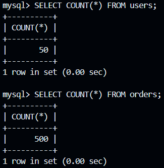
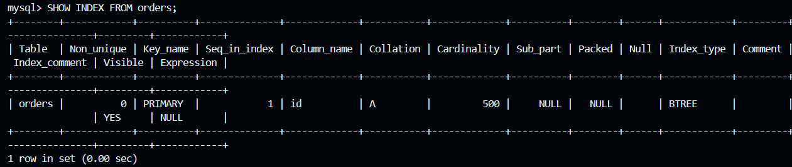
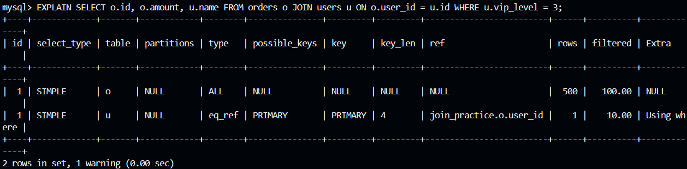
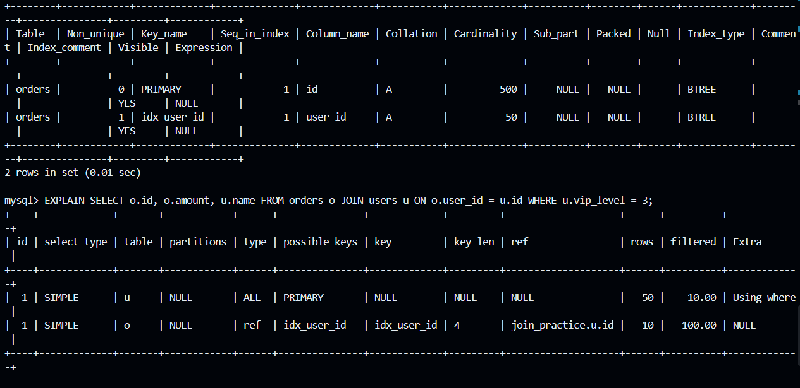
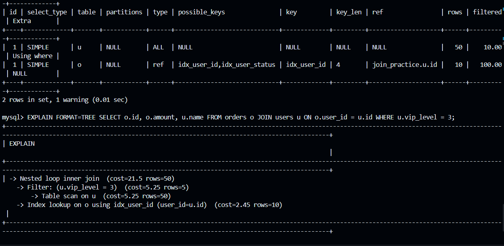
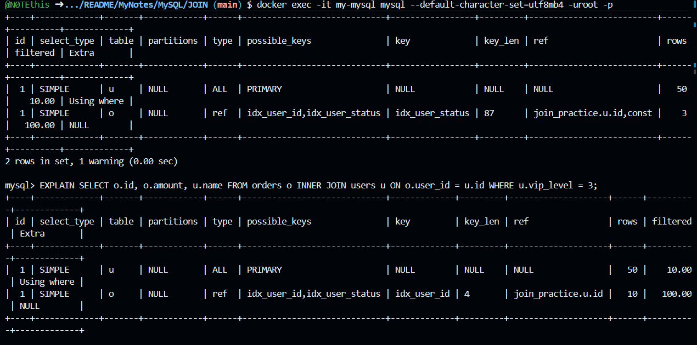

# 🚀 Индексы и `JOIN`: оптимизация соединений в MySQL


> Практическая работа: показать, почему `JOIN` без индекса на столбце соединения превращается в полный перебор (`type: ALL`), и как индекс заменяет его быстрым поиском (`type: ref`).

---

## 📑 Содержание

1. [Цель работы](#-цель-работы)
2. [Окружение](#-окружение)
3. [Структура репозитория](#-структура-репозитория)
4. [Ход работы](#-ход-работы)
5. [Результаты: до и после индекса](#-результаты-до-и-после-индекса)
6. [Скриншоты](#-скриншоты)
7. [Лог и дамп](#-лог-и-дамп)
8. [Выводы](#-выводы)
9. [Шпаргалка](#-шпаргалка)

---

## 🎯 Цель работы

Понять, как MySQL выполняет `JOIN`, и научиться проектировать индексы так, чтобы соединение шло через **поиск по B-дереву**, а не через **полный перебор**.

**Что было сделано:**

- [x] созданы таблицы `users` и `orders`, `JOIN` без индекса дал `type: ALL`;
- [x] создан индекс на `orders.user_id`, `type` сменился на `ref`;
- [x] разобрано автоматическое создание индексов для внешних ключей;
- [x] разобрана роль порядка соединения (таблица-драйвер);
- [x] рассмотрен составной индекс для `JOIN` + `WHERE`;
- [x] сравнены `INNER JOIN` и `LEFT JOIN`;
- [x] выгружены лог действий и дамп базы.

---

## 🧰 Окружение

| Компонент | Значение |
|-----------|----------|
| ОС | Windows + **WSL** |
| СУБД | MySQL 8.0 (Docker-образ `mysql:8.0`) |
| Контейнер | `my-mysql` |
| База данных | `join_practice` |
| Кодировка | `utf8mb4` / `utf8mb4_unicode_ci` |
| Логирование | `general_log` → `/var/lib/mysql/general.log` |

---

## 📂 Структура репозитория

```text
.
├── README.md          # этот файл
├── my.cnf             # конфигурация MySQL (кодировка + general_log)
├── my_actions.log     # лог только моих действий
├── general.log        # полный общий лог сервера
├── join_dump.sql      # дамп базы join_practice
├── export_logs.sh     # скрипт выгрузки лога и дампа
└── screen/            # скриншоты EXPLAIN и запуска
```

---

## 🛠 Ход работы

### 1. Конфигурация `my.cnf`

```ini
[mysqld]
character-set-server = utf8mb4
collation-server = utf8mb4_unicode_ci
general_log = 1
general_log_file = /var/lib/mysql/general.log
log_output = FILE

[client]
default-character-set = utf8mb4

[mysql]
default-character-set = utf8mb4
```

### 2. Запуск контейнера

```bash
docker stop my-mysql 2>/dev/null
docker rm my-mysql 2>/dev/null
docker volume rm mysql_data 2>/dev/null

docker run --name my-mysql \
  -e MYSQL_ROOT_PASSWORD=123 \
  -e LANG=C.UTF-8 \
  -e MYSQL_INITDB_SKIP_TZINFO=1 \
  -v mysql_data:/var/lib/mysql \
  -v $(pwd)/my.cnf:/etc/mysql/conf.d/my.cnf \
  -d mysql:8.0

# очистка лога перед началом работы
docker exec -u mysql my-mysql sh -c ': > /var/lib/mysql/general.log'

# подключение
docker exec -it my-mysql mysql --default-character-set=utf8mb4 -uroot -p
```

### 3. Схема и данные

Две таблицы: `users` (50 строк) и `orders` (500 строк). Индекса на `orders.user_id` **намеренно нет**.

```sql
CREATE DATABASE join_practice CHARACTER SET utf8mb4 COLLATE utf8mb4_unicode_ci;
USE join_practice;

CREATE TABLE users (
    id INT AUTO_INCREMENT PRIMARY KEY,
    name VARCHAR(100) NOT NULL,
    email VARCHAR(100) NOT NULL UNIQUE,
    vip_level INT DEFAULT 0
) CHARACTER SET utf8mb4 COLLATE utf8mb4_unicode_ci;

CREATE TABLE orders (
    id INT AUTO_INCREMENT PRIMARY KEY,
    user_id INT NOT NULL,
    order_date DATE NOT NULL,
    amount DECIMAL(10, 2) NOT NULL,
    status VARCHAR(20) DEFAULT 'new'
) CHARACTER SET utf8mb4 COLLATE utf8mb4_unicode_ci;
```

Проверка объёма данных:

```sql
SELECT COUNT(*) FROM users;   -- 50
SELECT COUNT(*) FROM orders;  -- 500
```

### 4. Эксперимент 1 — `JOIN` без индекса

```sql
EXPLAIN SELECT o.id, o.amount, u.name
FROM orders o
JOIN users u ON o.user_id = u.id
WHERE u.vip_level = 3;
```

Для `orders` ожидаем `type: ALL`: для каждой подходящей строки `users` MySQL просматривает все строки `orders`.

### 5. Эксперимент 2 — индекс на столбце соединения

```sql
CREATE INDEX idx_user_id ON orders(user_id);

EXPLAIN SELECT o.id, o.amount, u.name
FROM orders o
JOIN users u ON o.user_id = u.id
WHERE u.vip_level = 3;
```

Теперь для `orders` ожидаем `type: ref`, `key: idx_user_id` и заметно меньшее `rows`.

### 6. Составной индекс для `JOIN` + `WHERE`

```sql
CREATE INDEX idx_user_status ON orders(user_id, status);

EXPLAIN SELECT o.id, o.amount, u.name
FROM orders o
JOIN users u ON o.user_id = u.id
WHERE u.vip_level = 3 AND o.status = 'paid';
```

---

## 📊 Результаты: до и после индекса

> Значения в столбцах «до» и «после» нужно перенести со своих скриншотов `EXPLAIN`.

**Таблица `orders` (внутренняя в соединении):**

| Параметр | Без индекса | С `idx_user_id` |
|----------|:-----------:|:---------------:|
| `type` | `ALL` | `ref` |
| `key` | `NULL` | `idx_user_id` |
| `rows` | `___` | `___` |
| `Extra` | `___` | `___` |

**Как это читать:**

| `type` | Что значит | Оценка |
|--------|------------|:------:|
| `eq_ref` | поиск по PK/UNIQUE для каждой строки предыдущей таблицы | ✅ отлично |
| `ref` | поиск по неуникальному индексу | ✅ хорошо |
| `index` | полный просмотр индекса | ⚠️ средне |
| `ALL` | полный перебор таблицы | ❌ плохо |

---

## 🖼 Скриншоты













---

## 🧾 Лог и дамп

loggg : [loggg](./general.log)

dumppp :[dump](./join_dump.sql)

| Файл | Содержимое |
|------|------------|
| `my_actions.log` | только мои команды (`CREATE`, `INSERT`, `SELECT`, `EXPLAIN`, `SHOW`, `USE`, `ALTER`, `SET`, `DROP`) |
| `general.log` | полный общий лог сервера |
| `join_dump.sql` | дамп базы `join_practice` со всеми созданными индексами |

> ℹ️ Лог выгружается **до** дампа: иначе запросы `mysqldump` попадут в журнал и перемешаются с моими действиями.

---

## 💡 Выводы

1. **Индекс на столбце соединения — главное условие быстрого `JOIN`.** Без него внутренняя таблица читается целиком для каждой строки внешней: `type: ALL`, сложность порядка O(M × N).
2. **С индексом** тот же поиск идёт по B-дереву: `type: ref`, сложность порядка O(M × log N).
3. **Внешний ключ в InnoDB автоматически создаёт индекс** на столбце, если подходящего индекса ещё нет. В нашей схеме внешнего ключа нет, поэтому индекс создавался вручную.
4. **Порядок соединения** выбирает оптимизатор: обычно маленький отфильтрованный набор ведёт большой. В `EXPLAIN` таблицы перечислены в порядке соединения.
5. **Составной индекс `(join_col, filter_col)`** помогает, когда `JOIN` сопровождается фильтром по второму столбцу. Он работает по правилу левого префикса: эффективен для `user_id` и для пары `(user_id, status)`, но не для одного `status`.
6. **`INNER JOIN` даёт оптимизатору больше свободы**, чем `LEFT JOIN`, где левая таблица, как правило, фиксирована как ведущая. Для `LEFT JOIN` индекс на правой таблице обязателен.


## 📌 Шпаргалка

| Что хотите ускорить | Что сделать | Что должно быть в `EXPLAIN` |
|---------------------|-------------|-----------------------------|
| `JOIN` по столбцу | индекс на **внутренней** таблице | `ref` / `eq_ref` |
| `JOIN` по PK/UNIQUE | индекс уже есть | `eq_ref` |
| `JOIN` + фильтр | составной индекс `(join_col, filter_col)` | `ref`, меньше `rows` |
| `LEFT JOIN` | индекс на **правой** таблице | `ref` / `eq_ref` |
| маленькая + большая таблица | проверить, что маленькая ведёт | она первая в `EXPLAIN` |

---

