## Лабораторная # 1 работа по нормализации данных в БД (с ведением лога)

**Задачи:**
1. Создать базу `sales_norm` и «плохую» таблицу `orders_bad` в Docker-контейнере.
2. Продемонстрировать три аномалии (обновления, удаления, вставки).
3. Привести данные к **третьей нормальной форме (3NF)** (нормализовать) — разбить на 4 таблицы.
4. Перенести данные из «плохой» таблицы в нормализованные.
5. Проверить, что данные не потерялись и аномалии исчезли.
6. Сделать дамп базы до и после нормализации.
7. **Научиться вести лог действий пользователя и экспортировать его.**

> **Задание выполнять в VS Code - Git-Bash - Docker CLI!!**

Задача: Создать пошаговое руководство для начинающего по нормализации данных на примере этой таблицы:

Таблица "sales_unnormalized_2"
```markdown
| Код отчёта | Дата  | Код покупателя | Покупатель | Код товара | Название товара | Цена | Кол-во |
---------------------------------------------------------------------------------------------------
| 1101       | 05.03 | 12             | Дания      | 101        | Дыни            | 800  | 1100   |
|            |       |                |            | 102        | Клубника        | 150  | 300    |
| 1102       | 07.03 | 23             | Испания    | 103        | Яблоки          | 120  | 1700   |
| 1103       | 08.03 | 25             | Албания    | 104        | Лимоны          | 200  | 500    |
| 1104       | 10.03 | 12             | Дания      | 101        | Дыни            | 800  | 2500   |
| 1105       | 12.03 | 25             | Албания    | 103        | Яблоки          | 120  | 2000   |
|            |       |                |            | 104        | Лимоны          | 200  | 700    |
```

### 📋 Таблица `sales_unnormalized_2`

#### SQL-скрипт для создания и заполнения новой БД с ненормализованной таблицей

```sql
CREATE TABLE sales_unnormalized_2 (
    report_id     INT,
    report_date   DATE,
    customer_id   INT,
    customer_name VARCHAR(100),
    product_id    INT,
    product_name  VARCHAR(100),
    price         DECIMAL(10,2),
    quantity      INT
);

INSERT INTO sales_unnormalized_2 VALUES
(1101, '2026-03-05', 12, 'Дания',   101, 'Дыни',      800, 1100),
(1101, '2026-03-05', 12, 'Дания',   102, 'Клубника',  150,  300),
(1102, '2026-03-07', 23, 'Испания', 103, 'Яблоки',    120, 1700),
(1103, '2026-03-08', 25, 'Албания', 104, 'Лимоны',    200,  500),
(1104, '2026-03-10', 12, 'Дания',   101, 'Дыни',      800, 2500),
(1105, '2026-03-12', 25, 'Албания', 103, 'Яблоки',    120, 2000),
(1105, '2026-03-12', 25, 'Албания', 104, 'Лимоны',    200,  700);
```

Результат
```markdown

| report_id | report_date | customer_id | customer_name | product_id | product_name | price | quantity |
|-----------|-------------|-------------|---------------|------------|--------------|-------|----------|
| 1101      | 2026-03-05  | 12          | Дания         | 101        | Дыни         | 800   | 1100     |
| 1101      | 2026-03-05  | 12          | Дания         | 102        | Клубника     | 150   | 300      |
| 1102      | 2026-03-07  | 23          | Испания       | 103        | Яблоки       | 120   | 1700     |
| 1103      | 2026-03-08  | 25          | Албания       | 104        | Лимоны       | 200   | 500      |
| 1104      | 2026-03-10  | 12          | Дания         | 101        | Дыни         | 800   | 2500     |
| 1105      | 2026-03-12  | 25          | Албания       | 103        | Яблоки       | 120   | 2000     |
| 1105      | 2026-03-12  | 25          | Албания       | 104        | Лимоны       | 200   | 700      |
```

---

### 🧐 Нарушения нормализации

1. **Повторяющиеся группы** — в исходном визуальном представлении для одного отчёта с несколькими товарами данные покупателя и даты были указаны один раз. В реляционной таблице они продублированы в каждой строке, что создаёт избыточность.
2. **Нарушение 2NF** — первичный ключ здесь составной: `(report_id, product_id)`. Но `customer_name`, `report_date`, `customer_id` зависят только от `report_id`, а `product_name`, `price` — только от `product_id`. Это частичные зависимости.
3. **Нарушение 3NF** — транзитивные зависимости:
   - `customer_id → customer_name` (имя зависит от кода покупателя, а не от ключа).
   - `product_id → product_name, price` (название и цена зависят от кода товара).
4. **Аномалии**:
   - Обновление: при смене названия покупателя нужно править все его строки.
   - Вставка: нельзя добавить нового покупателя без отчёта.
   - Удаление: удалив все отчёты покупателя, теряем информацию о нём.

---

### 🎯 Задание для практики

Приведите таблицу `sales_unnormalized_2` к **третьей нормальной форме (3NF)**. В результате у вас должно получиться **четыре таблицы**:

1. **`customers`** — справочник покупателей:
   - `customer_id` (PK)
   - `customer_name`

2. **`products`** — справочник товаров:
   - `product_id` (PK)
   - `product_name`
   - `price`

3. **`reports`** — шапки отчётов (кто и когда):
   - `report_id` (PK)
   - `report_date`
   - `customer_id` (FK → customers)

4. **`report_items`** — позиции отчётов (что и сколько):
   - `report_id` (FK → reports)
   - `product_id` (FK → products)
   - `quantity`
   - Первичный ключ: `(report_id, product_id)`

---

### ✅ Порядок выполнения

1. Создайте новую базу (например, `normalization_task`) и в ней — таблицу `sales_unnormalized_2` с данными выше.
2. Создайте четыре нормализованные таблицы **рядом** с исходной.
3. Перенесите данные с помощью `INSERT ... SELECT`:
   - Уникальные покупатели → `customers`.
   - Уникальные товары → `products`.
   - Уникальные отчёты → `reports`.
   - Позиции → `report_items`.
4. Проверьте, что данные не потерялись и не исказились:
   - Сравните количество отчётов, покупателей, товаров.
   - Сравните общую сумму (`SUM(price * quantity)`) до и после.
5. Выполните несколько тестовых запросов на новой схеме (например, «сколько потратил покупатель с кодом 12?»).
6. Только после успешной проверки удалите или переименуйте исходную таблицу.

---

### 💡 Подсказки

- Для заполнения `customers` используйте `SELECT DISTINCT customer_id, customer_name FROM sales_unnormalized_2;`.
- Для `products` — `SELECT DISTINCT product_id, product_name, price FROM sales_unnormalized_2;`.
- Для `reports` — `SELECT DISTINCT report_id, report_date, customer_id FROM sales_unnormalized_2;`.
- Для `report_items` — прямое соединение исходной таблицы с `reports` и `products` по соответствующим ID (или просто `SELECT report_id, product_id, quantity FROM sales_unnormalized_2;`, так как `report_id` и `product_id` уже есть в исходной таблице).

Можно выполнить в имеющемя Docker-контейнере с MySQL: создать новую базу, перенести данные через `INSERT ... SELECT`, проверить суммы и только потом удалить исходную таблицу.

Результат оформить в виде отдельного `README.md` со скриншотами результатов ваших действий, дампом и логом (лог-файл должен содержать только ваши действия) в этой же папке и прислать ссылку преподавателю.


---

# Лабораторная работа №1
## Нормализация данных в базе данных до третьей нормальной формы (3NF)

### 1. Цель работы

Изучить принципы нормализации реляционных баз данных, познакомиться с аномалиями обновления, вставки и удаления данных, научиться приводить таблицы к третьей нормальной форме (3NF), создавать резервные копии базы данных и вести лог действий пользователя.

### 2. Используемые инструменты

- Visual Studio Code.
- Git Bash.
- Docker CLI.
- MySQL.
- SQL.

### 3. Создание базы данных

Была создана база данных `sales_norm` и исходная ненормализованная таблица `sales_unnormalized_2`.

В таблицу добавлено 7 записей, содержащих информацию о покупателях, товарах, отчётах, ценах и количестве.

**Результат:** исходная таблица успешно создана и заполнена данными.

*Скриншот 1 — создание базы данных и исходной таблицы.*

### 4. Демонстрация аномалий

В исходной таблице были обнаружены три вида аномалий:

**Аномалия обновления.** При изменении названия покупателя необходимо изменять все строки, в которых он встречается. Если изменить не все записи, информация станет противоречивой.

**Аномалия вставки.** Невозможно корректно хранить информацию о новом покупателе отдельно от отчёта и товара.

**Аномалия удаления.** При удалении последнего отчёта покупателя теряется информация о самом покупателе.

Для демонстрации использовались SQL-запросы UPDATE, INSERT и DELETE. После проверки изменения отменялись с помощью ROLLBACK.

*Скриншот 2 — демонстрация аномалий.*

### 5. Нормализация данных

Для устранения избыточности исходная таблица была разделена на четыре связанные таблицы.

| Таблица | Назначение |
|---|---|
| customers | Хранение покупателей |
| products | Хранение товаров |
| reports | Хранение отчётов |
| report_items | Хранение позиций отчётов |

**Таблица customers:**
- customer_id — первичный ключ.
- customer_name — название покупателя.

**Таблица products:**
- product_id — первичный ключ.
- product_name — название товара.
- price — цена товара.

**Таблица reports:**
- report_id — первичный ключ.
- report_date — дата отчёта.
- customer_id — внешний ключ.

**Таблица report_items:**
- report_id — внешний ключ.
- product_id — внешний ключ.
- quantity — количество товара.
- Составной первичный ключ: report_id и product_id.

### 6. Перенос данных

Данные были перенесены из исходной таблицы в новые с использованием SQL-конструкции INSERT INTO ... SELECT DISTINCT.

Перенос выполнялся в следующем порядке:

1. Покупатели в customers.
2. Товары в products.
3. Отчёты в reports.
4. Позиции отчётов в report_items.

После переноса все четыре таблицы были проверены с помощью SELECT.

*Скриншот 3 — таблица customers.*

*Скриншот 4 — таблица products.*

*Скриншот 5 — таблица reports.*

*Скриншот 6 — таблица report_items.*

### 7. Проверка сохранности данных

После нормализации было проведено сравнение количества записей.

| Таблица | Количество записей |
|---|---:|
| Исходная таблица | 7 |
| customers | 3 |
| products | 4 |
| reports | 5 |
| report_items | 7 |

Также была проверена общая стоимость товаров до и после нормализации.

Результаты:

- До нормализации: 3 609 000.
- После нормализации: 3 609 000.

Значения совпали, следовательно, данные были перенесены без потерь и искажений.

Дополнительно был выполнен запрос для определения общей суммы покупок покупателя с кодом 12.

Результат: 2 925 000.

*Скриншот 7 — проверка общей стоимости товаров.*

*Скриншот 8 — проверка покупателя с кодом 12.*

### 8. Проверка третьей нормальной формы

Созданная структура соответствует требованиям трёх нормальных форм:

- 1NF — все значения атомарные, повторяющиеся группы отсутствуют.
- 2NF — неключевые атрибуты полностью зависят от соответствующих первичных ключей.
- 3NF — транзитивные зависимости устранены путём разделения информации о покупателях, товарах и отчётах.

Таким образом, база данных приведена к третьей нормальной форме.

### 9. Резервное копирование

Были созданы два SQL-дампа:

- sales_norm_before.sql — резервная копия до нормализации.
- sales_norm_after.sql — резервная копия после нормализации.

### 10. Логирование действий

Для записи действий пользователя использовалась команда tee встроенного клиента MySQL.

Лог сохранён в файле actions.log.

В него записаны выполненные SQL-запросы и результаты проверок с момента включения логирования.

### 11. Вывод

В ходе лабораторной работы были изучены основные принципы нормализации баз данных.

Была создана ненормализованная таблица, продемонстрированы три основные аномалии, после чего данные были разделены на четыре связанные таблицы.

Проведённые проверки подтвердили сохранность исходной информации: количество записей и общая стоимость товаров совпали до и после нормализации.

В результате работы получена структура базы данных, соответствующая третьей нормальной форме (3NF). Также были освоены создание резервных копий MySQL и ведение лога действий пользователя.


---

ссылка на dump до:[dumpp](./sales_norm_before.sql)

ссылка на dump после:[ddump](./sales_norm_after.sql)

ссылка на log:[loggg](./general.log)

скриншоты ам ам ам:

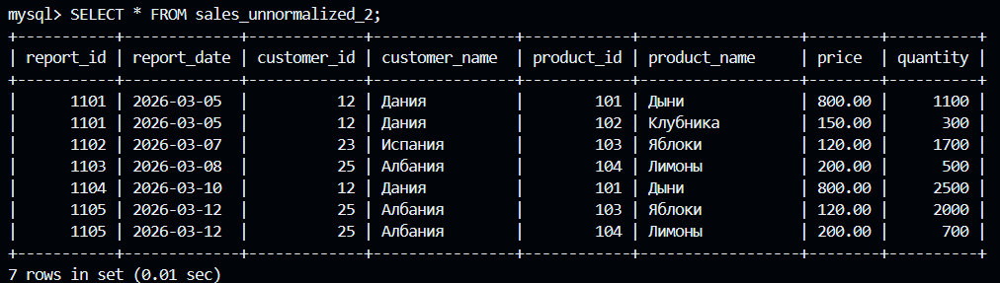

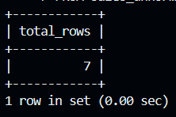

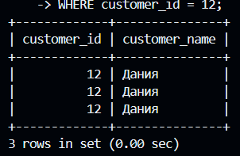

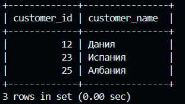

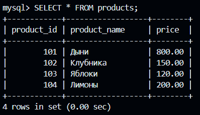

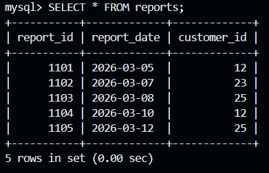

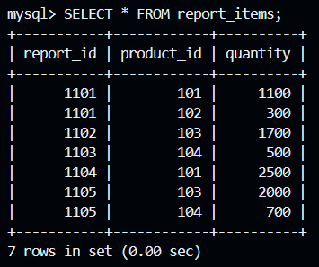

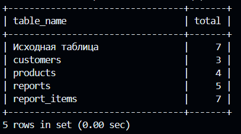

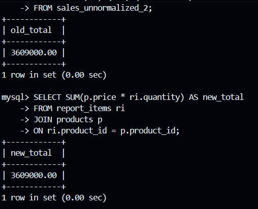

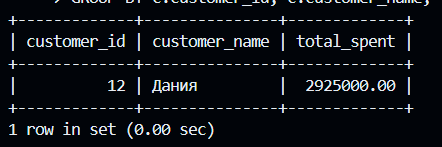

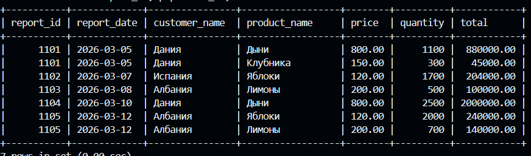

---