## Лабораторная # 2 работа по нормализации данных в БД (с ведением лога)

**Задачи:**
1. Создать базу `sales_norm` и «плохую» таблицу `orders_bad` в Docker-контейнере.
2. Продемонстрировать три аномалии (обновления, удаления, вставки).
3. Привести данные к **третьей нормальной форме (3NF)** (нормализовать) — разбить на 4 таблицы.
4. Перенести данные из «плохой» таблицы в нормализованные.
5. Проверить, что данные не потерялись и аномалии исчезли.
6. Сделать дамп базы до и после нормализации.
7. **Научиться вести лог действий пользователя и экспортировать его.**

> **Задание выполнять в VS Code - Git-Bash - Docker CLI!**

### 📋 Таблица `sales_unnormalized`

#### SQL-скрипт для создания и заполнения новой БД с ненормализованной таблицей

```sql
CREATE TABLE sales_unnormalized (
    sale_id       INT,
    sale_date     DATE,
    client_id     INT,
    client_name   VARCHAR(100),
    client_city   VARCHAR(100),
    product_id    INT,
    product_name  VARCHAR(100),
    unit_price    DECIMAL(10,2),
    quantity      INT
);

INSERT INTO sales_unnormalized VALUES
(5001, '2026-11-01', 101, 'Иванов Иван',     'Москва',           201, 'Монитор',    15000.00, 2),
(5001, '2026-11-01', 101, 'Иванов Иван',     'Москва',           202, 'Клавиатура',  2000.00, 1),
(5002, '2026-11-02', 102, 'Петрова Мария',   'Санкт-Петербург', 203, 'Мышь',        1000.00, 3),
(5002, '2026-11-02', 102, 'Петрова Мария',   'Санкт-Петербург', 204, 'Наушники',    3500.00, 1),
(5003, '2026-11-03', 101, 'Иванов Иван',     'Москва',           205, 'Колонки',     2500.00, 2),
(5004, '2026-11-04', 103, 'Сидоров Алексей', 'Казань',           202, 'Клавиатура',  2000.00, 5),
(5004, '2026-11-04', 103, 'Сидоров Алексей', 'Казань',           203, 'Мышь',        1000.00, 2),
(5005, '2026-11-05', 102, 'Петрова Мария',   'Санкт-Петербург', 201, 'Монитор',    15000.00, 1),
(5006, '2026-11-06', 103, 'Сидоров Алексей', 'Казань',           204, 'Наушники',    3500.00, 2),
(5006, '2026-11-06', 103, 'Сидоров Алексей', 'Казань',           205, 'Колонки',     2500.00, 1);
```

Результат:

| sale_id | sale_date  | client_id | client_name       | client_city       | product_id | product_name | unit_price | quantity |
|---------|------------|-----------|-------------------|-------------------|------------|--------------|------------|----------|
| 5001    | 2026-11-01 | 101       | Иванов Иван       | Москва            | 201        | Монитор      | 15000.00   | 2        |
| 5001    | 2026-11-01 | 101       | Иванов Иван       | Москва            | 202        | Клавиатура   | 2000.00    | 1        |
| 5002    | 2026-11-02 | 102       | Петрова Мария     | Санкт-Петербург   | 203        | Мышь         | 1000.00    | 3        |
| 5002    | 2026-11-02 | 102       | Петрова Мария     | Санкт-Петербург   | 204        | Наушники     | 3500.00    | 1        |
| 5003    | 2026-11-03 | 101       | Иванов Иван       | Москва            | 205        | Колонки      | 2500.00    | 2        |
| 5004    | 2026-11-04 | 103       | Сидоров Алексей   | Казань            | 202        | Клавиатура   | 2000.00    | 5        |
| 5004    | 2026-11-04 | 103       | Сидоров Алексей   | Казань            | 203        | Мышь         | 1000.00    | 2        |
| 5005    | 2026-11-05 | 102       | Петрова Мария     | Санкт-Петербург   | 201        | Монитор      | 15000.00   | 1        |
| 5006    | 2026-11-06 | 103       | Сидоров Алексей   | Казань            | 204        | Наушники     | 3500.00    | 2        |
| 5006    | 2026-11-06 | 103       | Сидоров Алексей   | Казань            | 205        | Колонки      | 2500.00    | 1        |


#### 🧐 Какие нарушения здесь есть

1. **Повторяющиеся группы**
   Для одной продажи (`sale_id`) данные клиента (`client_id`, `client_name`, `client_city`) и дата (`sale_date`) дублируются в каждой строке с товаром.

2. **Нарушение 2NF (частичные зависимости)**
   Потенциальный первичный ключ — составной: `(sale_id, product_id)`.
   - `client_name`, `client_city`, `sale_date` зависят **только от `sale_id`**, а не от всего ключа.
   - `product_name`, `unit_price` зависят **только от `product_id`**.

3. **Нарушение 3NF (транзитивные зависимости)**
   - `client_name → client_city` (город зависит от клиента, а не от ключа).
   - `product_name → unit_price` (цена зависит от товара).

4. **Аномалии**
   - Обновление: при смене города клиента нужно править много строк.
   - Вставка: нельзя добавить нового клиента, пока он не сделал покупку.
   - Удаление: удалив все продажи клиента, мы теряем информацию о нём.

---

#### 🎯 Задание для практики

Попробуйте привести эту таблицу к нормализации по **3NF**. В результате должны получиться как минимум четыре таблицы:

- `clients` (client_id, client_name, client_city)
- `products` (product_id, product_name, unit_price)
- `sales` (sale_id, sale_date, client_id)
- `sale_items` (sale_id, product_id, quantity)

Можно выполнить в имеющемя Docker-контейнере с MySQL: создать новую базу, перенести данные через `INSERT ... SELECT`, проверить суммы и только потом удалить исходную таблицу.

Результат оформить в виде отдельного `README.md` со скриншотами результатов ваших действий, дампом и логом (лог-файл должен содержать только ваши действия) в этой же папке и прислать ссылку преподавателю.

---

# Лабораторная работа №2. Нормализация данных в БД до третьей нормальной формы (3NF)

## 1. Цель работы

Изучить принципы нормализации реляционных баз данных, выявить аномалии обновления, удаления и вставки, привести ненормализованную таблицу к третьей нормальной форме (3NF), выполнить перенос данных и проверить их целостность.

Дополнительно изучить ведение журнала действий пользователя MySQL (General Log) и экспортирование журнала в отдельный файл.

## 2. Используемые инструменты

- Visual Studio Code.
- Git Bash.
- Docker CLI.
- MySQL.
- SQL.

## 3. Создание базы данных

Для выполнения лабораторной работы использовался Docker-контейнер `my-mysql`.

Создана база данных `sales_norm`, содержащая исходную ненормализованную таблицу `sales_unnormalized`.

В таблицу добавлено 10 записей о продажах, содержащих информацию о клиентах, товарах, датах продаж, ценах и количестве товаров.

## 4. Выявление аномалий

В исходной таблице были выявлены три основные аномалии.

**Аномалия обновления.**

Информация о клиентах повторялась в нескольких строках. Изменение города клиента требовало обновления нескольких записей.

**Аномалия удаления.**

При удалении всех покупок клиента терялась информация о самом клиенте.

**Аномалия вставки.**

Добавление нового клиента без создания записи о продаже было невозможно из-за структуры исходной таблицы.

Для демонстрации аномалий использовались транзакции и команда `ROLLBACK`, благодаря чему исходные данные сохранились.

## 5. Нормализация до 3NF

Исходная таблица была разделена на четыре связанные таблицы:

| Таблица | Назначение |
|---|---|
| clients | Информация о клиентах |
| products | Информация о товарах |
| sales | Информация о продажах |
| sale_items | Состав продаж и количество товаров |

Для обеспечения целостности данных использовались первичные ключи (PRIMARY KEY) и внешние ключи (FOREIGN KEY).

Данные были перенесены из исходной таблицы с помощью `INSERT INTO ... SELECT DISTINCT`.

## 6. Проверка результатов

После переноса данных выполнены проверки количества записей и общей стоимости продаж.

| Показатель | До нормализации | После нормализации |
|---|---:|---:|
| Позиции продаж | 10 | 10 |
| Общее количество товаров | 20 | 20 |
| Общая стоимость продаж | 80 000.00 | 80 000.00 |

Количество клиентов после нормализации — 3.

Количество товаров — 5.

Количество продаж — 6.

Результаты проверок подтвердили, что данные не были потеряны при переносе.

Также были повторно продемонстрированы операции добавления клиента, изменения его города и удаления продаж. После нормализации соответствующие аномалии были устранены.

## 7. Создание дампов

Были созданы два дампа базы данных:

- `sales_norm_before.sql` — структура и данные до нормализации.
- `sales_norm_after.sql` — структура и данные после нормализации.

После проверки переноса исходная таблица `sales_unnormalized` была удалена.

## 8. Ведение журнала General Log

Для регистрации действий пользователя был включён механизм General Log MySQL.

Использовались параметры:

- `general_log = ON`;
- `log_output = FILE`;
- `general_log_file = /var/lib/mysql/general.log`.

После завершения работы журналирование было отключено, а файл `general.log` экспортирован из Docker-контейнера в папку лабораторной работы.

Журнал содержит реальные SQL-запросы, выполненные во время лабораторной работы.

## 9. Вывод

В ходе лабораторной работы были изучены основные проблемы ненормализованных баз данных и способы их устранения.

Исходная таблица была приведена к третьей нормальной форме (3NF) путём разделения информации на четыре связанные таблицы.

Были устранены аномалии обновления, вставки и удаления. Проверка количества записей и общей стоимости продаж подтвердила сохранность данных.

Также были освоены создание дампов MySQL и ведение журнала действий пользователя с помощью General Log.

Цель лабораторной работы достигнута.

---

ссылка на DUMP до : [dumppp](./sales_norm_before.sql)

ссылка на DUMP после : [dddump](./sales_norm_after.sql)

ссылка на LOGGG : [loggg](./general.log)

---
 скриншоты ам ам ам :

 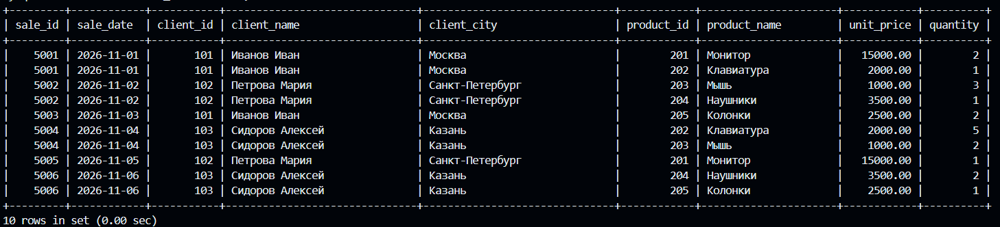

 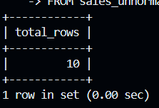

 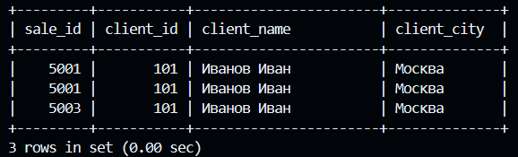

 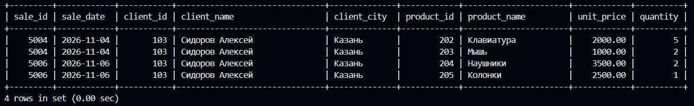

 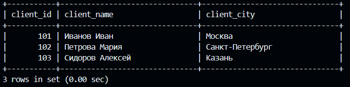

 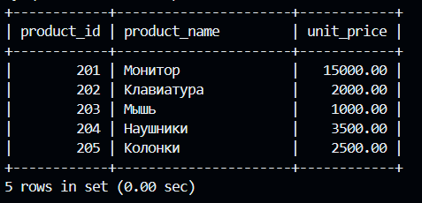

 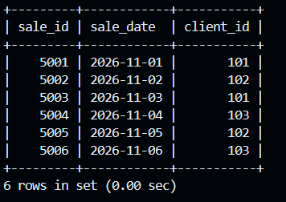

 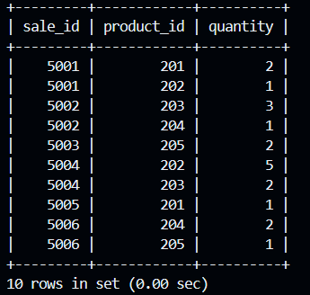

 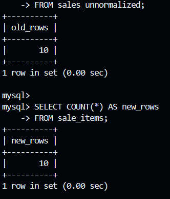

 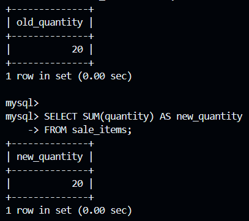

 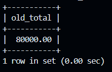

 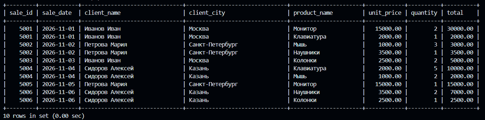

 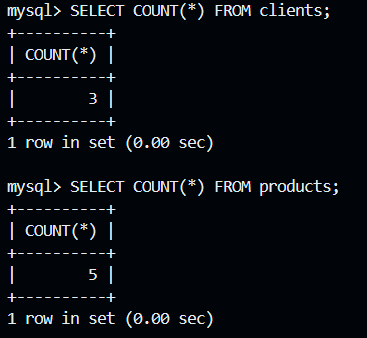

 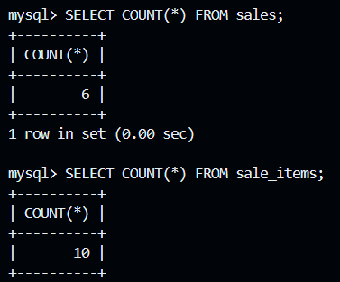

 ---