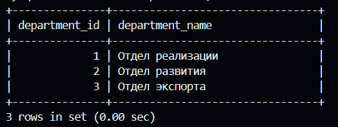
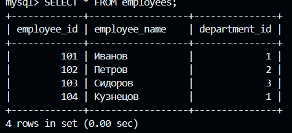
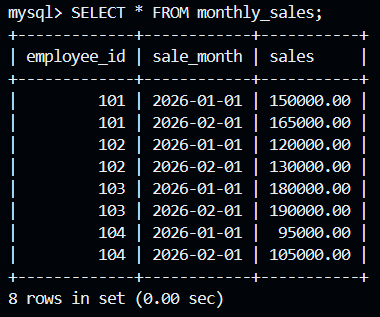
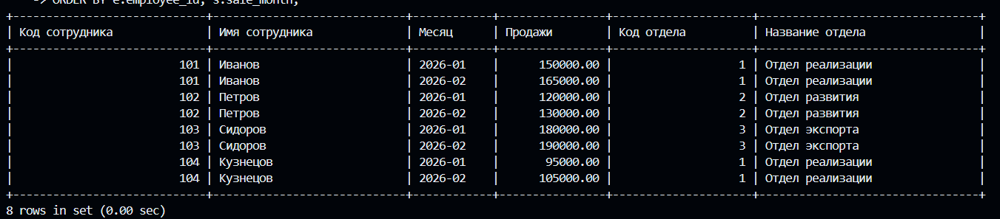
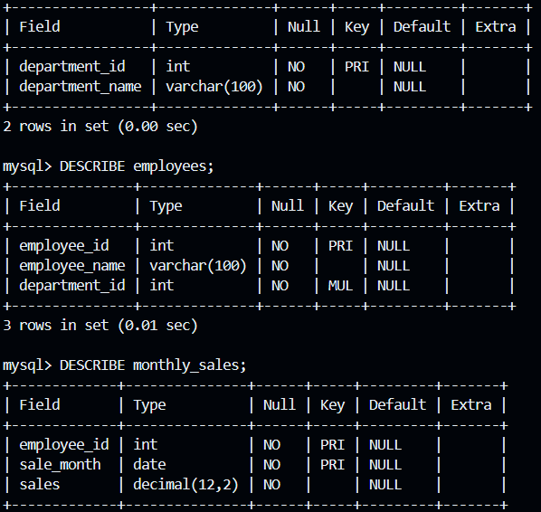

## Лабораторная # 3 работа по нормализации данных в БД (с ведением лога)

> **Задание выполнять в VS Code - Git-Bash - Docker CLI!**

Нормализуйте до третьей нормальной формы эту таблицу:

```markdown
| Код сотрудника | Имя сотрудника | Месяц | Продажи | Код отдела | Название Отдела  |-------------------------------------------------------------------------------------
|                |                |       |         |            | Отдел реализации |
|                |                |       |         |            | Отдел развития   |
|                |                |       |         |            | Отдел экспорта   |
```

Результат оформить в виде отдельного `README.md` со скриншотами результатов ваших действий, дампом и логом (лог-файл должен содержать только ваши действия) в этой же папке и прислать ссылку преподавателю.

---

# Лабораторная работа №3. Нормализация данных в БД до третьей нормальной формы

## 1. Цель работы

Привести исходную таблицу с информацией о сотрудниках, отделах и продажах к третьей нормальной форме (3НФ).

Закрепить навыки проектирования реляционных баз данных, создания связанных таблиц, использования первичных и внешних ключей, а также ведения журнала выполненных SQL-запросов (General Log).

## 2. Исходная таблица

Исходная таблица содержит следующие поля:

| Код сотрудника | Имя сотрудника | Месяц | Продажи | Код отдела | Название отдела |
|---|---|---|---|---|---|
| 101 | Иванов | 2026-01 | 150000 | 1 | Отдел реализации |
| 102 | Петров | 2026-01 | 120000 | 2 | Отдел развития |
| 103 | Сидоров | 2026-01 | 180000 | 3 | Отдел экспорта |
| 104 | Кузнецов | 2026-01 | 95000 | 1 | Отдел реализации |
| 101 | Иванов | 2026-02 | 165000 | 1 | Отдел реализации |
| 102 | Петров | 2026-02 | 130000 | 2 | Отдел развития |
| 103 | Сидоров | 2026-02 | 190000 | 3 | Отдел экспорта |
| 104 | Кузнецов | 2026-02 | 105000 | 1 | Отдел реализации |

*Примечание: сотрудники, месяцы и суммы продаж использованы в качестве учебных данных, поскольку конкретные значения в задании не указаны.*

## 3. Анализ исходной таблицы

При хранении всех сведений в одной таблице возникают следующие проблемы:

- Повторяются имена сотрудников при наличии данных о продажах за несколько месяцев.
- Повторяются названия отделов.
- При изменении названия отдела необходимо обновлять несколько записей.
- При удалении последней записи о продажах сотрудника можно потерять информацию о нём.

Для устранения избыточности необходимо разделить исходную таблицу на несколько связанных таблиц.

### Функциональные зависимости

Выделены следующие зависимости:

- Код сотрудника → Имя сотрудника, Код отдела.
- Код отдела → Название отдела.
- Код сотрудника + Месяц → Продажи.

## 4. Нормализация данных

### Первая нормальная форма (1НФ)

Все значения в таблице являются атомарными. Каждая ячейка содержит одно значение, повторяющиеся группы отсутствуют.

### Вторая нормальная форма (2НФ)

Все неключевые атрибуты должны полностью зависеть от первичного ключа.

Для таблицы продаж используется составной первичный ключ, состоящий из кода сотрудника и месяца.

### Третья нормальная форма (3НФ)

Устранены транзитивные зависимости. Название отдела зависит от кода отдела, а не непосредственно от кода сотрудника.

Поэтому сведения об отделах вынесены в отдельную таблицу.

## 5. Итоговая структура базы данных

После нормализации исходная таблица разделена на три связанные таблицы.

### 5.1. Таблица departments

Хранит информацию об отделах организации.

| Поле | Тип данных | Назначение |
|---|---|---|
| department_id | INT | Первичный ключ |
| department_name | VARCHAR(100) | Название отдела |

Содержимое таблицы:

| Код отдела | Название отдела |
|---|---|
| 1 | Отдел реализации |
| 2 | Отдел развития |
| 3 | Отдел экспорта |

### 5.2. Таблица employees

Хранит информацию о сотрудниках.

| Поле | Тип данных | Назначение |
|---|---|---|
| employee_id | INT | Первичный ключ |
| employee_name | VARCHAR(100) | Имя сотрудника |
| department_id | INT | Внешний ключ |

### 5.3. Таблица monthly_sales

Хранит информацию о ежемесячных продажах сотрудников.

| Поле | Тип данных | Назначение |
|---|---|---|
| employee_id | INT | Первичный и внешний ключ |
| sale_month | DATE | Первичный ключ, месяц продаж |
| sales | DECIMAL(12,2) | Сумма продаж |

Первичный ключ таблицы состоит из двух полей: employee_id и sale_month.

### Связи между таблицами

- departments и employees связаны отношением один ко многим.
- employees и monthly_sales связаны отношением один ко многим.

Для обеспечения ссылочной целостности используются внешние ключи (FOREIGN KEY).

## 6. Создание и заполнение базы данных

В Docker-контейнере MySQL была создана база данных `sales_norm`.

Непосредственно в консоли MySQL выполнены SQL-команды для:

1. Создания базы данных.
2. Создания таблиц departments, employees и monthly_sales.
3. Определения первичных и внешних ключей.
4. Добавления информации об отделах.
5. Добавления информации о сотрудниках.
6. Добавления данных о ежемесячных продажах.

**Скриншоты выполнения:**

*Здесь разместить скриншот создания базы данных и таблиц.*

## 7. Проверка результатов

Для проверки корректности созданной структуры выполнены запросы SELECT и DESCRIBE.

Также использован оператор JOIN для объединения трёх таблиц.

Это позволяет получить представление исходной таблицы, объединяя сведения о сотрудниках, продажах и отделах без физического дублирования данных.

**Скриншоты результатов:**

- Содержимое таблицы departments.
- Содержимое таблицы employees.
- Содержимое таблицы monthly_sales.
- Результат объединения таблиц с помощью JOIN.
- Структура таблиц после нормализации.

## 8. Ведение General Log

Для регистрации действий в MySQL был включён General Log.

Использовались следующие параметры:

- `general_log = ON` — включение журналирования.
- `log_output = FILE` — сохранение журнала в файл.
- `general_log_file = /var/lib/mysql/general.log` — путь к журналу внутри Docker-контейнера.

После выполнения всех SQL-команд журналирование было отключено.

Затем файл `general.log` был скопирован из Docker-контейнера в папку лабораторной работы.

Журнал содержит выполненные в ходе лабораторной SQL-запросы, включая создание базы данных и таблиц, добавление данных, проверочные запросы и объединение таблиц.

## 9. Создание дампа базы данных

Для сохранения структуры базы данных и всех содержащихся в ней данных использована утилита `mysqldump`.

Создан файл `sales_norm_dump.sql`, содержащий структуру таблиц, ограничения и добавленные записи.

Дамп позволяет восстановить базу данных в дальнейшем.

## 10. Структура файлов лабораторной работы

В результате выполнения лабораторной подготовлены следующие файлы:

| Файл | Содержание |
|---|---|
| README.md | Отчёт о выполненной лабораторной работе |
| general.log | Журнал выполненных действий MySQL |
| sales_norm_dump.sql | Дамп базы данных |

Дополнительно в папке размещены скриншоты выполнения работы.

## 11. Вывод

В ходе лабораторной работы была создана база данных `sales_norm` и выполнена нормализация исходной таблицы до третьей нормальной формы.

Исходная структура была разделена на три связанные таблицы: departments, employees и monthly_sales.

В процессе работы были использованы первичные и внешние ключи, обеспечивающие целостность и согласованность данных.

С помощью SQL-запросов SELECT, DESCRIBE и JOIN проверена корректность созданной структуры и возможность получения исходного представления данных.

Дополнительно был настроен General Log для регистрации выполненных действий MySQL и создан дамп базы данных с помощью mysqldump.

В результате получена нормализованная структура базы данных, соответствующая требованиям третьей нормальной формы.

---

ссылка на dump :[dump](./sales_norm_dump.sql)

ссылка на loggg :[loggg](./general.log)

скриншоты ам ам ам :









