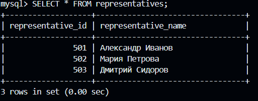
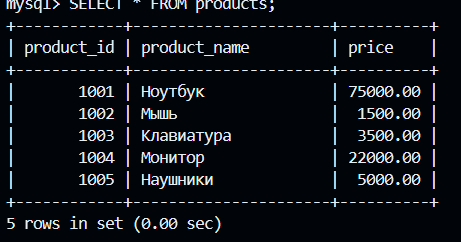
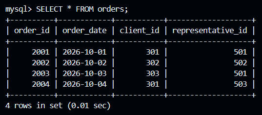
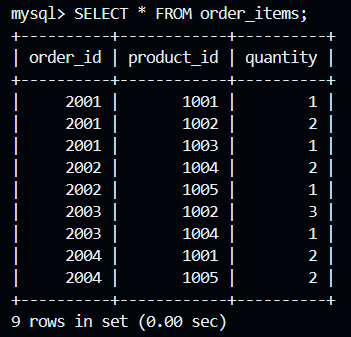
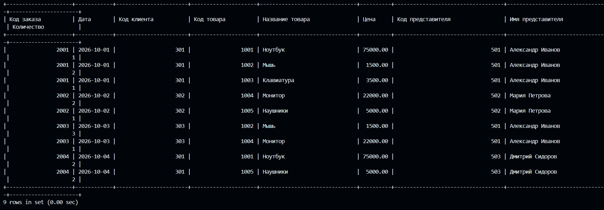
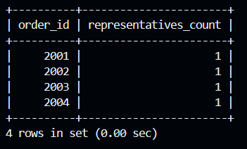
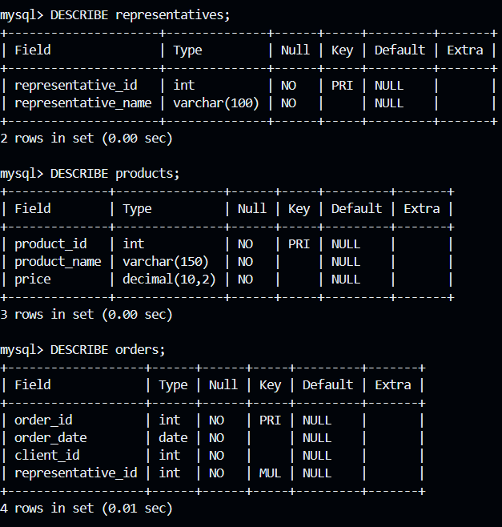
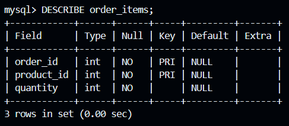

## Лабораторная # 4 работа по нормализации данных в БД (с ведением лога)

> **Задание выполнять в VS Code - Git-Bash - Docker CLI!**

Нормализуйте до третьей нормальной формы эту таблицу, но проводите каждого клиента по коду заказа, где один код заказа должен соответствовать только одному представителю:
```markdown
| Код заказа | Дата | Код клиента | Код товара | Название товара | Цена  | Код представителя | Имя представителя | Количество |
-------------------------------------------------------------------------------------------------------------------------------
|            |      |             |            |                 |       |                   |                   |            |
```

Результат оформить в виде отдельного `README.md` со скриншотами результатов ваших действий, дампом и логом (лог-файл должен содержать только ваши действия) в этой же папке и прислать ссылку преподавателю.

---

# Лабораторная работа №4. Нормализация данных в БД до третьей нормальной формы

## 1. Цель работы

Выполнить нормализацию исходной таблицы с информацией о заказах, клиентах, товарах и представителях до третьей нормальной формы (3НФ).

Изучить функциональные зависимости, научиться разделять данные на связанные таблицы, использовать первичные и внешние ключи, а также вести журнал выполненных SQL-запросов (General Log).

Особое условие задания: каждый код заказа должен соответствовать только одному представителю.

## 2. Исходная таблица

Исходная таблица содержит следующие поля:

| Код заказа | Дата | Код клиента | Код товара | Название товара | Цена | Код представителя | Имя представителя | Количество |
|---|---|---|---|---|---:|---|---|---:|
| 2001 | 2026-10-01 | 301 | 1001 | Ноутбук | 75000 | 501 | Александр Иванов | 1 |
| 2001 | 2026-10-01 | 301 | 1002 | Мышь | 1500 | 501 | Александр Иванов | 2 |
| 2001 | 2026-10-01 | 301 | 1003 | Клавиатура | 3500 | 501 | Александр Иванов | 1 |
| 2002 | 2026-10-02 | 302 | 1004 | Монитор | 22000 | 502 | Мария Петрова | 2 |
| 2002 | 2026-10-02 | 302 | 1005 | Наушники | 5000 | 502 | Мария Петрова | 1 |
| 2003 | 2026-10-03 | 303 | 1002 | Мышь | 1500 | 501 | Александр Иванов | 3 |
| 2003 | 2026-10-03 | 303 | 1004 | Монитор | 22000 | 501 | Александр Иванов | 1 |
| 2004 | 2026-10-04 | 301 | 1001 | Ноутбук | 75000 | 503 | Дмитрий Сидоров | 2 |
| 2004 | 2026-10-04 | 301 | 1005 | Наушники | 5000 | 503 | Дмитрий Сидоров | 2 |

*Примечание: данные являются учебными, поскольку конкретные значения в задании не указаны.*

## 3. Анализ исходной таблицы

В исходной таблице присутствует избыточность данных:

- Информация о заказе повторяется для каждой товарной позиции.
- Названия товаров и их цены дублируются.
- Имена представителей повторяются в нескольких записях.
- При изменении информации о товаре или представителе необходимо обновлять несколько строк.

Для устранения избыточности необходимо разделить исходную таблицу на несколько связанных таблиц.

### Функциональные зависимости

Выделены следующие функциональные зависимости:

- Код заказа → Дата, Код клиента, Код представителя.
- Код товара → Название товара, Цена.
- Код представителя → Имя представителя.
- Код заказа + Код товара → Количество.

Важное условие: одному коду заказа соответствует только один код представителя. Представитель закрепляется за заказом, а не за отдельной товарной позицией.

## 4. Нормализация данных

### Первая нормальная форма (1НФ)

Все значения являются атомарными. Каждая товарная позиция представлена отдельной записью. Повторяющиеся группы отсутствуют.

### Вторая нормальная форма (2НФ)

Все неключевые атрибуты должны полностью зависеть от первичного ключа.

В таблице состава заказов используется составной первичный ключ: код заказа и код товара. Количество зависит от обоих атрибутов.

### Третья нормальная форма (3НФ)

Устранены транзитивные зависимости.

Название товара и его цена вынесены в отдельную таблицу товаров, а имя представителя — в таблицу представителей.

Сведения о заказе, включая код клиента и код представителя, хранятся отдельно от товарных позиций.

## 5. Итоговая структура базы данных

После нормализации исходная таблица разделена на четыре связанные таблицы.

### 5.1. Таблица representatives

Хранит информацию о представителях.

| Поле | Тип данных | Назначение |
|---|---|---|
| representative_id | INT | Первичный ключ |
| representative_name | VARCHAR(100) | Имя представителя |

### 5.2. Таблица products

Хранит информацию о товарах.

| Поле | Тип данных | Назначение |
|---|---|---|
| product_id | INT | Первичный ключ |
| product_name | VARCHAR(150) | Название товара |
| price | DECIMAL(10,2) | Цена товара |

### 5.3. Таблица orders

Хранит информацию о заказах.

| Поле | Тип данных | Назначение |
|---|---|---|
| order_id | INT | Первичный ключ |
| order_date | DATE | Дата заказа |
| client_id | INT | Код клиента |
| representative_id | INT | Внешний ключ |

Код представителя хранится непосредственно в таблице заказов. Это обеспечивает соответствие одного заказа одному представителю.

### 5.4. Таблица order_items

Хранит информацию о товарных позициях каждого заказа.

| Поле | Тип данных | Назначение |
|---|---|---|
| order_id | INT | Первичный и внешний ключ |
| product_id | INT | Первичный и внешний ключ |
| quantity | INT | Количество товара |

Первичный ключ таблицы состоит из двух полей: order_id и product_id.

## 6. Связи между таблицами

В созданной базе данных установлены следующие связи:

- representatives и orders — один ко многим;
- orders и order_items — один ко многим;
- products и order_items — один ко многим.

Для обеспечения ссылочной целостности используются внешние ключи FOREIGN KEY.

Код клиента хранится в таблице orders, поскольку исходное задание не содержит дополнительных сведений о клиентах.

## 7. Создание и заполнение базы данных

В Docker-контейнере MySQL была создана база данных `orders_norm`.

Непосредственно в консоли MySQL выполнены SQL-команды для:

1. Создания базы данных.
2. Создания четырёх таблиц.
3. Определения первичных и внешних ключей.
4. Добавления информации о представителях.
5. Добавления информации о товарах.
6. Добавления заказов с указанием клиентов и представителей.
7. Добавления товарных позиций в заказы.

**Скриншоты выполнения:**

*Здесь разместить скриншот создания базы данных и таблиц.*

## 8. Проверка результатов

Для проверки корректности созданной структуры выполнены запросы SELECT и DESCRIBE.

С помощью оператора JOIN объединены четыре таблицы, что позволяет получить представление, аналогичное исходной таблице.

Дополнительно выполнена проверка количества представителей для каждого заказа с использованием COUNT(DISTINCT representative_id).

Результат проверки показывает, что каждому заказу соответствует только один представитель.

**Скриншоты результатов:**

- Содержимое таблицы representatives.
- Содержимое таблицы products.
- Содержимое таблицы orders.
- Содержимое таблицы order_items.
- Результат объединения таблиц с помощью JOIN.
- Проверка соответствия одного представителя каждому заказу.
- Структура таблиц через DESCRIBE.

## 9. Ведение General Log

Для регистрации выполненных действий в MySQL был включён General Log.

Использовались следующие параметры:

- `general_log = ON` — включение журналирования.
- `log_output = FILE` — сохранение журнала в файл.
- `general_log_file = /var/lib/mysql/lab4_general.log` — путь к журналу внутри Docker-контейнера.

После выполнения SQL-команд журналирование было отключено.

Файл журнала был скопирован из Docker-контейнера в папку лабораторной работы и сохранён под именем `general.log`.

Журнал содержит действия, выполненные в рамках данной лабораторной работы.

## 10. Создание дампа базы данных

Для сохранения структуры базы данных и всех содержащихся в ней данных использована утилита `mysqldump`.

Создан файл `orders_norm_dump.sql`, содержащий структуру таблиц, ограничения и добавленные записи.

Дамп позволяет восстановить базу данных в дальнейшем.

## 11. Структура файлов лабораторной работы

В результате выполнения лабораторной подготовлены следующие файлы:

| Файл | Содержание |
|---|---|
| README.md | Отчёт о выполненной лабораторной работе |
| general.log | Журнал выполненных действий MySQL |
| orders_norm_dump.sql | Дамп базы данных |

Дополнительно в папке размещены скриншоты выполнения работы.

## 12. Вывод

В ходе лабораторной работы была создана база данных `orders_norm` и выполнена нормализация исходной таблицы до третьей нормальной формы.

Исходная таблица была разделена на четыре связанные таблицы: representatives, products, orders и order_items.

Для обеспечения целостности данных использованы первичные и внешние ключи.

Особое внимание уделено условию задания: каждому коду заказа соответствует только один представитель. Для этого код представителя хранится непосредственно в таблице заказов.

С помощью SQL-запросов SELECT, DESCRIBE и JOIN проверена корректность созданной структуры и возможность получения исходного представления данных.

Дополнительно был настроен General Log для регистрации выполненных действий MySQL и создан дамп базы данных с помощью mysqldump.

В результате получена нормализованная структура базы данных, соответствующая требованиям третьей нормальной формы.

---

ссылка на dumppp :[dumppp](./orders_norm_dump.sql)

ссылка на loggg :[loggg](./general.log)

скриншоты ам ам ам :

















