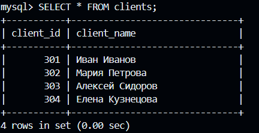
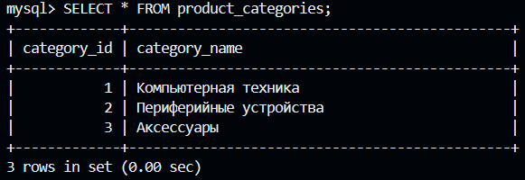
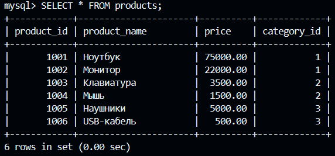
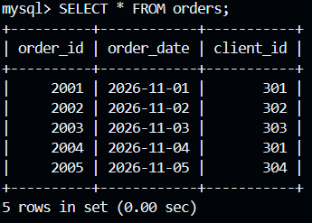
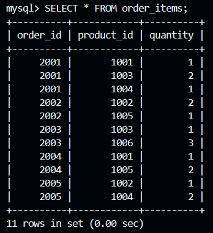
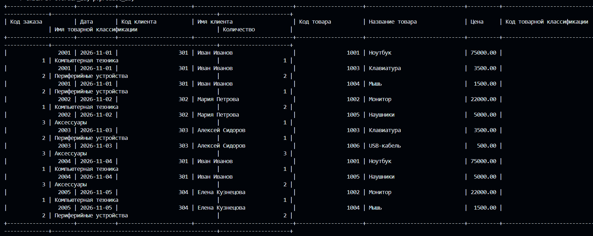
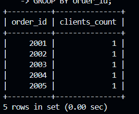
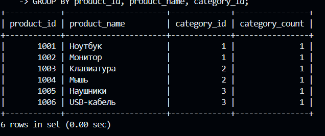
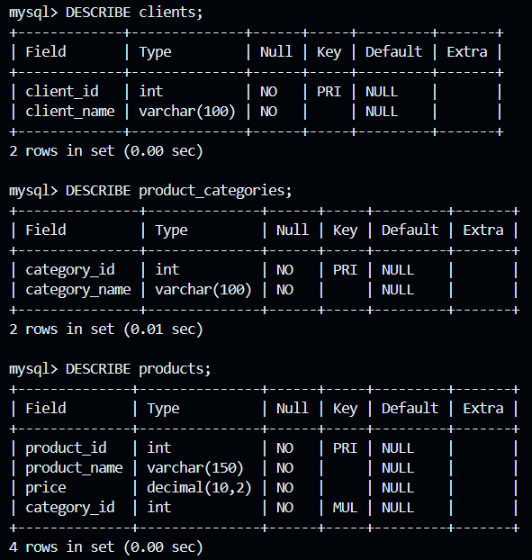
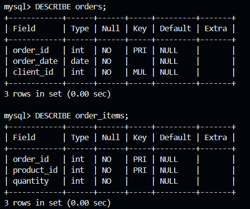

## Лабораторная # 5 работа по нормализации данных в БД (с ведением лога)

> **Задание выполнять в VS Code - Git-Bash - Docker CLI!**

Нормализуйте до третьей нормальной формы эту таблицу, но проводите каждого клиента по коду заказа и пусть товары классифицируются по коду товара:
```markdown
| Код заказа | Дата | Код клиента | Имя клиента | Код товара | Название товара | Цена  | Код товарной классификации | Имя товарной классификации | Количество |
---------------------------------------------------------------------------------------------------------------------------------------------------------------
|            |      |             |             |            |                 |       |                            |                            |            |
```

Результат оформить в виде отдельного `README.md` со скриншотами результатов ваших действий, дампом и логом (лог-файл должен содержать только ваши действия) в этой же папке и прислать ссылку преподавателю.

---

# Лабораторная работа №5. Нормализация данных в БД до третьей нормальной формы (3НФ)

## 1. Цель работы

Изучить процесс нормализации реляционной базы данных до третьей нормальной формы (3НФ), устранить избыточность данных и транзитивные зависимости.

В ходе работы необходимо:
- Создать исходную ненормализованную таблицу заказов.
- Продемонстрировать переход к первой нормальной форме (1НФ).
- Выполнить преобразование ко второй нормальной форме (2НФ).
- Выполнить преобразование к третьей нормальной форме (3НФ).
- Проверить правильность связей между полученными таблицами.
- Сохранить General Log и дамп базы данных.

## 2. Исходная структура данных

Изначально все сведения о заказах, клиентах, товарах и классификациях хранятся в одной таблице.

| Код заказа | Дата | Код клиента | Имя клиента | Код товара | Название товара | Цена | Код классификации | Название классификации | Количество |
|---|---|---|---|---|---|---:|---|---|---:|
| 2001 | 2026-11-01 | 301 | Иван Иванов | 1001 | Ноутбук | 75000 | 1 | Компьютерная техника | 1 |
| 2001 | 2026-11-01 | 301 | Иван Иванов | 1003 | Клавиатура | 3500 | 2 | Периферийные устройства | 2 |
| 2001 | 2026-11-01 | 301 | Иван Иванов | 1004 | Мышь | 1500 | 2 | Периферийные устройства | 1 |
| 2002 | 2026-11-02 | 302 | Мария Петрова | 1002 | Монитор | 22000 | 1 | Компьютерная техника | 2 |
| 2002 | 2026-11-02 | 302 | Мария Петрова | 1005 | Наушники | 5000 | 3 | Аксессуары | 1 |
| 2003 | 2026-11-03 | 303 | Алексей Сидоров | 1003 | Клавиатура | 3500 | 2 | Периферийные устройства | 1 |

В исходной таблице присутствует избыточность: сведения о клиентах, товарах и классификациях повторяются в нескольких строках.

## 3. Создание базы данных и исходной таблицы

Создадим базу данных:

```sql
CREATE DATABASE IF NOT EXISTS orders_classification_norm;
USE orders_classification_norm;
```

Создадим исходную таблицу `orders_bad`:

```sql
CREATE TABLE orders_bad (
    order_id INT,
    order_date DATE,
    client_id INT,
    client_name VARCHAR(100),
    product_id INT,
    product_name VARCHAR(150),
    price DECIMAL(10,2),
    category_id INT,
    category_name VARCHAR(100),
    quantity INT
);
```

Заполним таблицу исходными данными:

```sql
INSERT INTO orders_bad VALUES
(2001, '2026-11-01', 301, 'Иван Иванов', 1001, 'Ноутбук', 75000, 1, 'Компьютерная техника', 1),
(2001, '2026-11-01', 301, 'Иван Иванов', 1003, 'Клавиатура', 3500, 2, 'Периферийные устройства', 2),
(2001, '2026-11-01', 301, 'Иван Иванов', 1004, 'Мышь', 1500, 2, 'Периферийные устройства', 1),
(2002, '2026-11-02', 302, 'Мария Петрова', 1002, 'Монитор', 22000, 1, 'Компьютерная техника', 2),
(2002, '2026-11-02', 302, 'Мария Петрова', 1005, 'Наушники', 5000, 3, 'Аксессуары', 1),
(2003, '2026-11-03', 303, 'Алексей Сидоров', 1003, 'Клавиатура', 3500, 2, 'Периферийные устройства', 1);
```

Проверим содержимое:

```sql
SELECT * FROM orders_bad;
```

## 4. Первая нормальная форма (1НФ)

Для выполнения первой нормальной формы необходимо, чтобы:
- Все значения атрибутов были атомарными.
- Каждое поле содержало только одно значение.
- Строки можно было однозначно идентифицировать.

В исходной таблице все значения атомарны. Для идентификации каждой позиции заказа используется составной ключ из кода заказа и кода товара.

Выполним добавление первичного ключа:

```sql
ALTER TABLE orders_bad
ADD PRIMARY KEY (order_id, product_id);
```

Проверим структуру:

```sql
DESCRIBE orders_bad;
```

**Результат:** таблица приведена к первой нормальной форме. Каждая позиция заказа имеет уникальное сочетание кода заказа и кода товара.

## 5. Вторая нормальная форма (2НФ)

Для перехода ко второй нормальной форме необходимо устранить частичные зависимости от составного первичного ключа.

В исходной таблице:
- `order_id` определяет дату заказа и код клиента.
- `client_id` определяет имя клиента.
- `product_id` определяет название товара, цену и код классификации.
- Сочетание `order_id` и `product_id` определяет количество товара.

Создадим отдельные таблицы для клиентов, заказов, товаров и позиций заказов.

### 5.1. Таблица клиентов

```sql
CREATE TABLE clients (
    client_id INT PRIMARY KEY,
    client_name VARCHAR(100) NOT NULL
);
```

Заполним таблицу:

```sql
INSERT INTO clients VALUES
(301, 'Иван Иванов'),
(302, 'Мария Петрова'),
(303, 'Алексей Сидоров');
```

### 5.2. Таблица заказов

```sql
CREATE TABLE orders (
    order_id INT PRIMARY KEY,
    order_date DATE NOT NULL,
    client_id INT NOT NULL,
    FOREIGN KEY (client_id) REFERENCES clients(client_id)
);
```

Заполним таблицу:

```sql
INSERT INTO orders VALUES
(2001, '2026-11-01', 301),
(2002, '2026-11-02', 302),
(2003, '2026-11-03', 303);
```

### 5.3. Таблица товаров

```sql
CREATE TABLE products (
    product_id INT PRIMARY KEY,
    product_name VARCHAR(150) NOT NULL,
    price DECIMAL(10,2) NOT NULL,
    category_id INT NOT NULL
);
```

Заполним таблицу:

```sql
INSERT INTO products VALUES
(1001, 'Ноутбук', 75000, 1),
(1002, 'Монитор', 22000, 1),
(1003, 'Клавиатура', 3500, 2),
(1004, 'Мышь', 1500, 2),
(1005, 'Наушники', 5000, 3);
```

### 5.4. Таблица позиций заказов

```sql
CREATE TABLE order_items (
    order_id INT NOT NULL,
    product_id INT NOT NULL,
    quantity INT NOT NULL,
    PRIMARY KEY (order_id, product_id),
    FOREIGN KEY (order_id) REFERENCES orders(order_id),
    FOREIGN KEY (product_id) REFERENCES products(product_id)
);
```

Заполним таблицу:

```sql
INSERT INTO order_items VALUES
(2001, 1001, 1),
(2001, 1003, 2),
(2001, 1004, 1),
(2002, 1002, 2),
(2002, 1005, 1),
(2003, 1003, 1);
```

**Результат:** данные разделены на отдельные таблицы. Атрибуты зависят от ключей соответствующих таблиц, а количество товара зависит от полного составного ключа позиции заказа.

## 6. Третья нормальная форма (3НФ)

Для перехода к третьей нормальной форме необходимо устранить транзитивные зависимости.

В таблице товаров код классификации определяет название классификации:

`category_id → category_name`

Следовательно, название классификации не должно храниться непосредственно в таблице товаров. Создадим отдельную таблицу классификаций.

```sql
CREATE TABLE product_categories (
    category_id INT PRIMARY KEY,
    category_name VARCHAR(100) NOT NULL
);
```

Заполним её:

```sql
INSERT INTO product_categories VALUES
(1, 'Компьютерная техника'),
(2, 'Периферийные устройства'),
(3, 'Аксессуары');
```

Добавим внешний ключ в таблицу товаров:

```sql
ALTER TABLE products
ADD CONSTRAINT fk_products_category
FOREIGN KEY (category_id)
REFERENCES product_categories(category_id);
```

**Результат:** информация о классификациях вынесена в отдельную таблицу. Теперь каждый товар связан с классификацией через `category_id`, а название классификации хранится отдельно.

## 7. Проверка полученной структуры

Посмотрим структуру всех таблиц:

```sql
DESCRIBE clients;
DESCRIBE orders;
DESCRIBE products;
DESCRIBE product_categories;
DESCRIBE order_items;
```

Проверим содержимое таблиц:

```sql
SELECT * FROM clients;
SELECT * FROM orders;
SELECT * FROM products;
SELECT * FROM product_categories;
SELECT * FROM order_items;
```

## 8. Объединение таблиц

Чтобы получить исходное представление заказов после нормализации, объединим таблицы с помощью `JOIN`.

```sql
SELECT
    o.order_id AS 'Код заказа',
    o.order_date AS 'Дата',
    c.client_id AS 'Код клиента',
    c.client_name AS 'Имя клиента',
    p.product_id AS 'Код товара',
    p.product_name AS 'Название товара',
    p.price AS 'Цена',
    pc.category_id AS 'Код товарной классификации',
    pc.category_name AS 'Имя товарной классификации',
    oi.quantity AS 'Количество'
FROM orders o
JOIN clients c ON o.client_id = c.client_id
JOIN order_items oi ON o.order_id = oi.order_id
JOIN products p ON oi.product_id = p.product_id
JOIN product_categories pc ON p.category_id = pc.category_id
ORDER BY o.order_id, p.product_id;
```

## 9. Проверка связей

Проверим, что каждый заказ связан с одним клиентом:

```sql
SELECT
    order_id,
    COUNT(DISTINCT client_id) AS clients_count
FROM orders
GROUP BY order_id;
```

Проверим связь товаров с классификациями:

```sql
SELECT
    p.product_id,
    p.product_name,
    pc.category_id,
    pc.category_name
FROM products p
JOIN product_categories pc
ON p.category_id = pc.category_id;
```

## 10. Итоговая структура базы данных

После нормализации получено пять таблиц:

| Таблица | Назначение |
|---|---|
| `clients` | Хранит информацию о клиентах |
| `orders` | Хранит информацию о заказах |
| `products` | Хранит информацию о товарах |
| `product_categories` | Хранит классификации товаров |
| `order_items` | Хранит товары и их количество в заказах |

Связи между таблицами:

- `clients` → `orders`: один клиент может иметь несколько заказов.
- `orders` → `order_items`: один заказ может содержать несколько товаров.
- `products` → `order_items`: один товар может встречаться в нескольких заказах.
- `product_categories` → `products`: одна классификация может содержать несколько товаров.

## 11. Ведение General Log

Для регистрации SQL-команд использовался General Log MySQL.

Проверка состояния журнала:

```sql
SHOW VARIABLES LIKE 'general_log';
SHOW VARIABLES LIKE 'general_log_file';
SHOW VARIABLES LIKE 'log_output';
```

В ходе лабораторной работы журнал включался с помощью:

```sql
SET GLOBAL log_output = 'FILE';
SET GLOBAL general_log_file = '/var/lib/mysql/lab5_general.log';
SET GLOBAL general_log = ON;
```

После завершения выполнения команд журнал отключался:

```sql
SET GLOBAL general_log = OFF;
```

Файл журнала был скопирован из Docker-контейнера в папку лабораторной работы под именем `general.log`.

## 12. Создание дампа базы данных

Для сохранения структуры и данных базы данных использовалась команда:

```bash
docker exec my-mysql mysqldump -uroot -p123 --databases orders_classification_norm > orders_classification_norm_dump.sql
```

Дамп содержит структуру созданных таблиц и внесённые данные.

## 13. Итог

В ходе лабораторной работы была изучена и выполнена нормализация базы данных до третьей нормальной формы.

Исходная таблица была разделена на пять связанных таблиц: клиентов, заказов, товаров, классификаций и позиций заказов.

В результате были устранены частичные и транзитивные зависимости, уменьшено дублирование данных и созданы связи между таблицами с помощью первичных и внешних ключей.

Полученная структура соответствует требованиям третьей нормальной формы (3НФ).


---

ссылка на dumppp : [dumppp](./orders_classification_norm_dump.sql)

ссылка на loggg : [loggg](./general.log)

скриншоты ам ам ам :



















